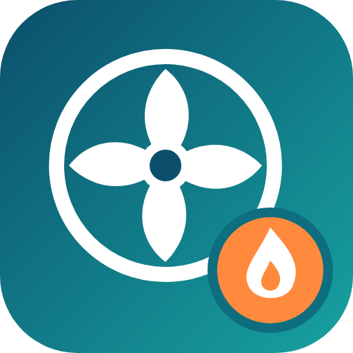

<p align="center"></p>

# Panasonic Aquarea Home Assistant Integration

A custom Home Assistant integration for Panasonic Aquarea heat pumps using the aioaquarea library.

## Features

- **Climate Control**: Control heating/cooling modes and temperature settings for each zone
- **Temperature Monitoring**: Monitor current temperatures for all zones and tank
- **Water Heater Control**: Control and monitor the hot water tank (if equipped)
- **Energy Monitoring**: Measured kWh for today (total, heating, cooling, hot water) from Panasonic's statistics, usable in the Energy dashboard. See `ENERGY_MONITORING.md`.
- **Special modes**: Eco, comfort, quiet, powerful, force heater, holiday and force DHW switches
- **Activity Integration**: Automatic logging of all changes to Home Assistant's Activity widget
- **Polling**: One cloud request per device every 90 seconds by default (configurable under **Configure**, minimum 60 s). Panasonic rate-limits its cloud API, so failures back off automatically up to 15 minutes.

## Installation

### Method 1: Manual Installation

1. Copy the `custom_components/panasonic_aquarea` folder to your Home Assistant `config/custom_components/` directory.

2. Restart Home Assistant.

3. Go to **Settings** → **Devices & Services** → **Add Integration** and search for "Panasonic Aquarea".

### Method 2: HACS (Recommended)

1. Add this repository as a custom repository in HACS:

   - Go to HACS → Integrations → ⋯ → Custom repositories
   - Repository: `https://github.com/Joachimdj/panasonic-homeassistant-integration`
   - Category: Integration

2. Install the integration through HACS.

3. Restart Home Assistant.

4. Add the integration through the UI.

## Configuration

1. In Home Assistant, go to **Settings** → **Devices & Services**.
2. Click **Add Integration** and search for "Panasonic Aquarea".
3. Enter your Panasonic Smart Cloud credentials:
   - **Username**: Your Panasonic Smart Cloud email
   - **Password**: Your Panasonic Smart Cloud password

## Entities

After configuration, the integration will create the following entities for each device:

### Climate Entities

- `climate.{device_name}_{zone_name}` - Climate control for each zone
- `number.{device_name}_{zone_name}_offset` - Heating-curve offset (compensation-curve zones only)

### Sensor Entities

#### Temperature Sensors
- `sensor.{device_name}_{zone_name}_temperature` - Current temperature for each zone
- `sensor.{device_name}_tank_temperature` - Tank temperature (if equipped)
- `sensor.{device_name}_outdoor_temperature` - Outdoor temperature

#### Energy Sensors (measured, refreshed hourly)
- `sensor.{device_name}_energy_today`, `_heating_energy_today`, `_cooling_energy_today`, `_dhw_energy_today` (kWh)

#### Status Sensors
- `sensor.{device_name}_operation_mode`, `_direction`, `_pump_duty`, `_fault`, `_water_pressure`, `_tank_target_temperature`, and diagnostic flags (bivalent, deice, electric anode, ...)
- Sensors that mirrored a switch (quiet, powerful, force DHW, ...) or read data the cloud never sends (eco/comfort flags, legionella, reheat, ...) were removed and their entries are cleaned up automatically.

### Water Heater Entities

- `water_heater.{device_name}_water_heater` - Hot water tank control (if equipped). Operation modes: `off`, `heat_pump`, `performance` (= force DHW).

### Switches

`Eco Mode`, `Comfort Mode`, `Quiet Mode`, `Powerful Mode`, `Force Heater`, `Holiday Mode` and (with a tank) `Force DHW`. Eco and comfort are mutually exclusive presets, also available as climate presets. Quiet turns on level 1, powerful runs for 30 minutes.

### How controls behave

- Commands are sent to the Panasonic cloud and the entity shows the new state after the next (debounced, ~15 s) refresh. Nothing is shown optimistically; if a command fails you get an error in the UI.
- *Direct* zones expose their target temperature on the climate entity. *Compensation curve* zones (like most weather-compensated installs) have an **offset** instead of a temperature: it is a `number` entity (`number.{device}_{zone}_offset`), and the climate entity has no target slider. min/max come from the device; the offset follows the current mode (heat or cool).
- Setting the temperature while the heat pump is off is rejected.
- The old Schedule, DHW priority, Legionella and Reheat switches were removed: the cloud API library has no calls for them.

## Example Device: "My Heat Pump"

A single-zone device with a tank gives these entities:

```yaml
climate.my_heat_pump_house
number.my_heat_pump_house_offset
sensor.my_heat_pump_house_temperature
sensor.my_heat_pump_tank_temperature
water_heater.my_heat_pump_water_heater
```

## Automation Examples

### Set heating schedule

```yaml
automation:
  - alias: "Morning Heating"
    trigger:
      platform: time
      at: "06:00:00"
    action:
      - service: climate.set_hvac_mode
        target:
          entity_id: climate.my_heat_pump_zone_1
        data:
          hvac_mode: heat
      - service: climate.set_temperature
        target:
          entity_id: climate.my_heat_pump_zone_1
        data:
          temperature: 22
```

### Tank temperature monitoring

```yaml
automation:
  - alias: "Low Tank Temperature Alert"
    trigger:
      platform: numeric_state
      entity_id: sensor.my_heat_pump_tank_temperature
      below: 45
    action:
      - service: notify.mobile_app_your_phone
        data:
          message: "Hot water tank temperature is low: {{ states('sensor.my_heat_pump_tank_temperature') }}°C"
```

## Troubleshooting

### Download diagnostics

Settings → Devices & services → Panasonic Aquarea → ⋮ → **Download diagnostics**. The file contains the poll interval, the last error, the parsed state of the zones and tank, and the raw status the cloud returned. Credentials, your e-mail, device ids and the device name are removed, so it is safe to attach to a bug report.

### Authentication Issues

- Verify your Panasonic Smart Cloud credentials
- Check that your account has access to the device
- Try logging out and back in to the Panasonic Smart Cloud app

### Connection Issues

- Check your internet connection
- Verify the Panasonic Smart Cloud service is operational
- Check Home Assistant logs for detailed error messages

### No Devices Found

- Ensure your device is properly connected to the Panasonic Smart Cloud
- Check that the device appears in the official Panasonic app
- Wait a few minutes and try reloading the integration

## Support

- [GitHub Issues](https://github.com/Joachimdj/panasonic-homeassistant-integration/issues)
- [Home Assistant Community Forum](https://community.home-assistant.io/)

## Credits

This integration uses the [aioaquarea](https://github.com/cjaliaga/aioaquarea) library by Carlos J. Aliaga.

## Development

```bash
pip install -r requirements_test.txt
pytest                                # runs the integration in a real Home Assistant with a fake cloud (tests_ha/)
python tests/test_controls.py         # quick stub-based checks against the real aioaquarea classes
python tests/test_status_sensors.py
```

`tests_ha/` covers setup, entity creation and cleanup, every control and service, error reporting, the request budget, the options/reauth/config flows and reload. CI runs it on every pull request.
